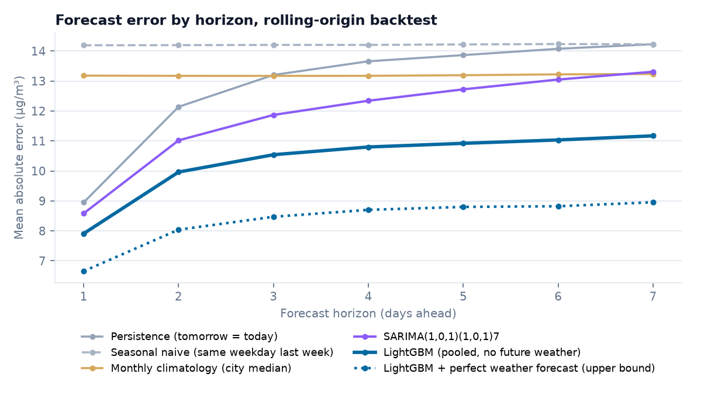
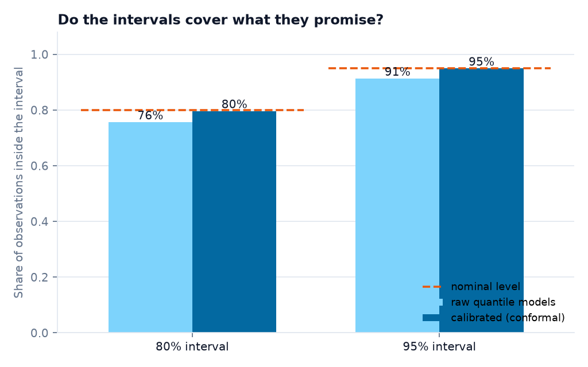
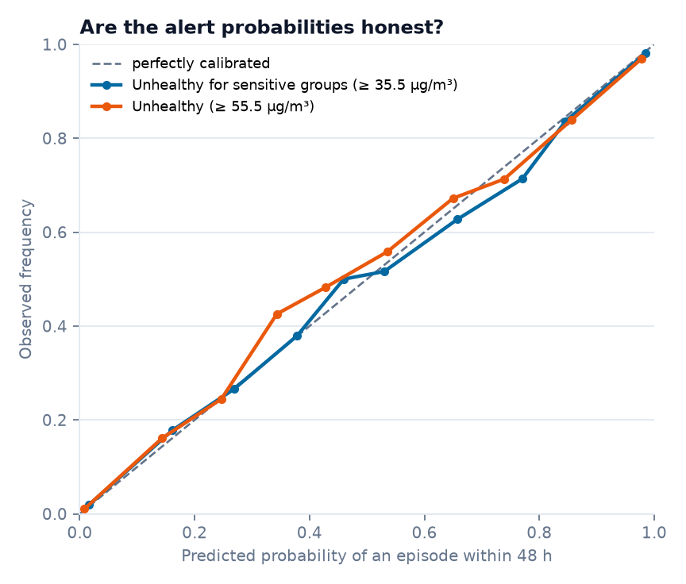
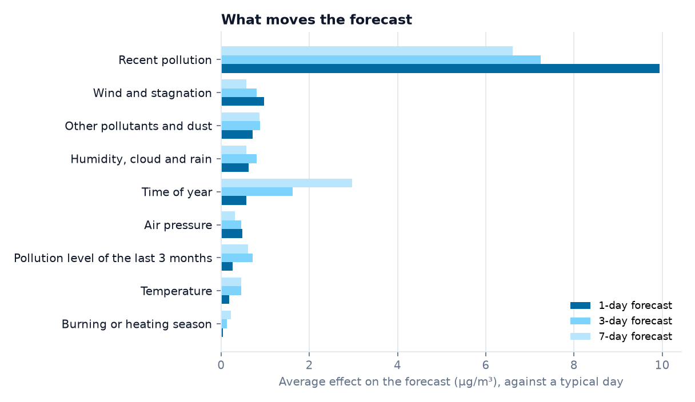

# Global AQI Forecaster

Seven-day PM2.5 forecasts for 42 cities on six continents, or any place you search for, with uncertainty
bands, a calibrated 48-hour pollution-episode alert, the reasons behind each forecast and a planner for the
cleanest hours of the day.

<!-- LIVE:START -->
Run it locally with `streamlit run app.py` (setup below).
<!-- LIVE:END -->

## What it does

- **Forecasts 1 to 7 days ahead** from recent pollution, wind, temperature, humidity, pressure, season and
  the local burning or heating season. Each forecast comes with 80% and 95% intervals.
- **48-hour alert.** Probability that the daily mean PM2.5 reaches AQI 101 (35.5 µg/m³) or AQI 151
  (55.5 µg/m³) within two days, with "watch" and "likely" levels. Probabilities are calibrated and the alert is
  scored on episodes that start after a clean day, which a rule like "today is already bad" cannot catch.
- **Explains itself.** Replaces one driver at a time (wind, temperature, humidity, season, burning season ...)
  with what is typical for the city and month, and shows how much the forecast moves, in plain sentences.
- **Plan your day.** The cleanest three hours of the day, with the expected hourly curve, and health guidance
  by category for six groups (general public, asthma and heart or lung disease, children, older adults,
  pregnancy, outdoor workers and athletes).
- **World view.** Map, rankings, cities currently under alert, side-by-side comparison. A scheduled job
  refreshes it daily.
- **Track record tab.** Every number the models are judged by, straight from the backtest.
- **API.** A small FastAPI service exposes forecasts, alerts and advice.

## Things you will not find in a basic AQI app

| Feature | Why it matters |
|---|---|
| Calibrated episode probability | A number you can read as a chance, checked on a reliability plot |
| Intervals with measured coverage | The 80% band should hold about 80% of outcomes, and the backtest checks that |
| Counterfactual drivers | Answers "how much is today's wind or the burning season worth?" |
| Cleanest-window planner, tested on unseen days | Gives a time to exercise, not just a level |
| Physical-model reference line | Shows where the statistical forecast and the CAMS atmospheric model agree |
| Percentile context | "Worse than 90% of days in November for this city" |

## Method

**Data.** Hourly PM2.5, PM10, NO2, SO2, ozone, CO, dust and aerosol optical depth from the CAMS global
atmospheric model, and hourly weather from ERA5 reanalysis, both through the [Open-Meteo](https://open-meteo.com)
API, from September 2022. Hours are averaged to local calendar days (at least 18 valid hours).

**This is model data, not monitor data.** CAMS is a global model with a grid of about 45 km. It captures
regional pollution well and the burning, dust and weather patterns that drive it, but it is smoother than a
street-level monitor and can miss local peaks. Treat the output as regional air quality.

**Models.** One pooled model per horizon learns from all cities at once (location, season and local
season flags are features). Compared against:

| Model | Role |
|---|---|
| Persistence | Tomorrow equals today |
| Seasonal naive | Same weekday last week |
| Monthly climatology | The city's typical value for the month |
| SARIMA(1,0,1)(1,0,1)7 | Classical time-series model, fitted per city |
| LightGBM | Gradient-boosted quantile regression on log PM2.5, features from the past only |
| LightGBM + perfect weather | Upper bound: shows how much a better weather forecast could add |

The weather of the forecast day is not a model input, because a real forecaster does not have it.

**Evaluation.** Rolling-origin backtest: four consecutive 91-day blocks, expanding training window, every
model trained only on days before its block. No random splits anywhere. Intervals are calibrated by split
conformal prediction on the last 90 days before each block. All models are scored on the same forecasts.

**AQI.** US EPA 2024 PM2.5 breakpoints. The WHO 2021 daily guideline of 15 µg/m³ is shown for context.

## Results

<!-- RESULTS:START -->
_Generated by `python evaluate.py` on 2026-11-15 from data up to 2026-11-08. Backtest: 4 consecutive blocks of 91 forecast days (2025-11-03 to 2026-11-01), 42 cities, 15,288 one-day-ahead forecasts per model. Every model is trained only on days before its block starts._

#### Forecast error: MAE in µg/m³ (lower is better)

| Model | 1 day | 2 days | 3 days | 5 days | 7 days | All horizons |
|---|---|---|---|---|---|---|
| Persistence (tomorrow = today) | 8.9 | 12.1 | 13.2 | 13.9 | 14.2 | 12.9 |
| Seasonal naive (same weekday last week) | 14.2 | 14.2 | 14.2 | 14.2 | 14.2 | 14.2 |
| Monthly climatology (city median) | 13.2 | 13.2 | 13.2 | 13.2 | 13.2 | 13.2 |
| SARIMA(1,0,1)(1,0,1)7 | 8.6 | 11.0 | 11.9 | 12.7 | 13.3 | 11.8 |
| LightGBM (pooled, no future weather) | 7.9 | 10.0 | 10.5 | 10.9 | 11.2 | 10.3 |
| LightGBM + perfect weather forecast (upper bound) | 6.7 | 8.0 | 8.5 | 8.8 | 9.0 | 8.3 |

Against persistence, the LightGBM model's MAE is 12% lower at 1 day, 21% lower at 7 days and 20% lower over all horizons. Against SARIMA, its MAE over all horizons is 13% lower. Handing the model the real weather of the forecast day would make its MAE 19% lower; that is the most a better weather forecast could add.



#### Error on high-pollution days (observed PM2.5 of at least 35.5 µg/m³)

| Model | 1 day | 2 days | 3 days | 5 days | 7 days | All horizons |
|---|---|---|---|---|---|---|
| Persistence (tomorrow = today) | 16.9 | 23.0 | 24.9 | 25.8 | 26.6 | 24.2 |
| Seasonal naive (same weekday last week) | 26.5 | 26.6 | 26.6 | 26.6 | 26.6 | 26.6 |
| Monthly climatology (city median) | 28.2 | 28.2 | 28.2 | 28.3 | 28.4 | 28.3 |
| SARIMA(1,0,1)(1,0,1)7 | 17.2 | 22.5 | 24.5 | 26.5 | 27.9 | 24.5 |
| LightGBM (pooled, no future weather) | 15.3 | 19.5 | 20.6 | 21.4 | 21.9 | 20.2 |
| LightGBM + perfect weather forecast (upper bound) | 12.9 | 15.7 | 16.6 | 17.3 | 17.6 | 16.4 |

#### Prediction intervals

Intervals come from quantile models and are then calibrated on the most recent 90 days before each block (split-conformal correction). The nominal 80% interval covered 80% of observations (raw: 76%); the nominal 95% interval covered 95% (raw: 91%).



#### 48-hour episode alert

An episode means a daily mean PM2.5 at or above the threshold on either of the next two days (`usg` = 35.5, `unhealthy` = 55.5 µg/m³). "New episodes" are those that start when today is still below the threshold, which a rule based on today's value can never catch.

| Threshold | Episode rate | ROC-AUC | Alert rule | Precision | Recall | New episodes caught |
|---|---|---|---|---|---|---|
| usg | 37.7% | 0.97 | model, p >= 0.30 (watch) | 84% | 92% | 62% of 1215 |
| usg | 37.7% | 0.97 | model, p >= 0.60 (likely) | 91% | 84% | 36% of 1215 |
| usg | 37.7% | 0.97 | rule: today's value is already above the threshold | 90% | 79% | 0% of 1215 |
| unhealthy | 22.4% | 0.98 | model, p >= 0.30 (watch) | 81% | 90% | 60% of 859 |
| unhealthy | 22.4% | 0.98 | model, p >= 0.60 (likely) | 90% | 77% | 27% of 859 |
| unhealthy | 22.4% | 0.98 | rule: today's value is already above the threshold | 88% | 75% | 0% of 859 |



#### What drives the forecast

Averaged over test forecasts, the largest drivers of the 1-day forecast are recent pollution (9.9 µg/m³), wind and stagnation (1.0 µg/m³), other pollutants and dust (0.7 µg/m³). Each effect is how much the forecast changes if that driver family is set to what is typical for the city and month. Effects are computed one family at a time, so they do not add up exactly.



#### Best time of day

On 15,288 unseen city-days, choosing the window the model recommends (cleanest 3 hours between 06:00 and 22:00, using a typical daily shape learned before the test period) lowered PM2.5 exposure by 22.3% compared with a randomly chosen window. The median city saw 20.2%, and the recommendation was better than average in 100% of cities. The air-quality model has 3-hourly steps, so the daily shape is coarse.
<!-- RESULTS:END -->

## Limitations

- Grid-cell model data, not street-level measurements (see above).
- Beyond three days the forecast leans on the seasonal average; sudden events (a fire, a dust storm) are
  missed until they appear in the data.
- Seasonal-driver months per city (for example crop-residue burning in Delhi and Lahore in October and
  November) are assumptions from the literature, not fitted values.
- The history is only since September 2022, so each season has been seen two to four times.
- Not medical advice.

## Run it

```bash
git clone https://github.com/ankittsenn/global-aqi-forecaster
cd global-aqi-forecaster
pip install -r requirements-dev.txt

python build_data.py        # downloads hourly data for all cities (15 to 25 minutes, resumable)
python evaluate.py          # backtest; writes results/ and fills the Results section above
python train.py             # final models -> models/bundle.pkl
python update_snapshot.py   # world view table
streamlit run app.py        # dashboard
uvicorn api.main:app        # optional API, docs at http://127.0.0.1:8000/docs
python -m pytest -q         # tests
```

`python evaluate.py --fast` runs a quick version with small models; `--skip-sarima` leaves out the slow
classical model.

## Project layout

```
airq/            library: data, features, models, backtest, explanations, planner, live forecasting
app.py           Streamlit dashboard
api/             FastAPI service
build_data.py    download and daily dataset
evaluate.py      time-based backtest, figures, README results
train.py         final models
update_snapshot.py   daily world table (run by .github/workflows)
tests/           unit tests
```

## Data and licences

Weather and air-quality data by [Open-Meteo.com](https://open-meteo.com) (CC BY 4.0, non-commercial free
tier). Contains modified Copernicus Atmosphere Monitoring Service information. Generated using Copernicus
Climate Change Service information. Neither the European Commission nor ECMWF is responsible for any use
that may be made of the information it contains. Code: MIT.

## Author

Ankit Kumar · [GitHub](https://github.com/ankittsenn) · [LinkedIn](https://www.linkedin.com/in/ankit-sen-aa90881b8)

General information only, not medical advice. If you feel unwell or have a heart or lung condition, follow
your doctor's advice.
